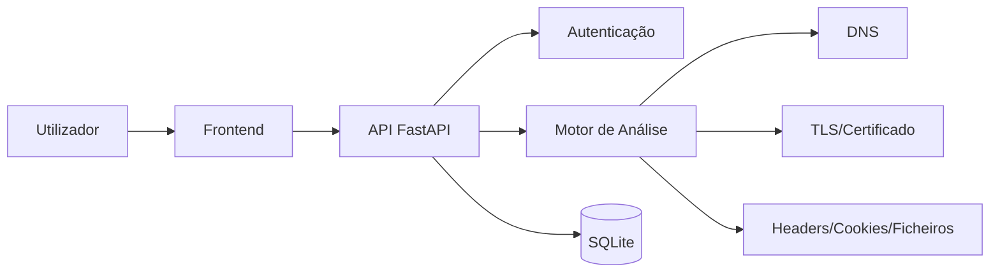

---

# Arquitetura — WebSec Check

## Visão geral
O sistema segue uma arquitetura cliente-servidor com três componentes principais:
- frontend;
- backend;
- base de dados.

## Componentes

### Frontend
Desenvolvido em Next.js.
Responsável por:
- registo;
- login;
- submissão de URLs;
- visualização de resultados;
- visualização do histórico.

### Backend
Desenvolvido em FastAPI.
Responsável por:
- autenticação;
- validação de dados;
- execução das análises;
- cálculo do score;
- armazenamento de resultados;
- consulta do histórico.

### Base de dados
SQLite.
Responsável por:
- guardar utilizadores;
- guardar análises;
- guardar findings.

## Diagrama

