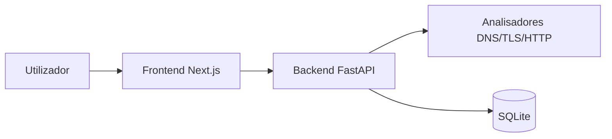

# Documento de Visão — WebSec Check

## 1. Objetivo
O WebSec Check é uma aplicação web com base de dados que permite a utilizadores autenticados analisar a postura básica de segurança de websites. O sistema recebe um domínio ou URL, executa uma análise externa , não intrusiva, e apresenta um relatório com dados técnicos relevantes incluindo: DNS/IP, HTTPS/TLS, validade de certificados, headers de segurança, cookies, ficheiros públicos e findings.

O sistema também guarda o histórico pessoal de análises de cada utilizador, permitindo consultar pesquisas anteriores com data, hora, URL e resultados principais.

## 2. Escopo
O sistema destina-se a contexto académico, formativo e técnico. Pode ser usado por:
- Estudantes de informática e cibersegurança;
- Programadores web;
- Administradores de websites;
- Equipas técnicas que pretendam fazer uma avaliação inicial de segurança.

O sistema não substitui auditorias profissionais nem testes de penetração completos.

## 3. Partes interessadas (Stakeholders)
As partes interessadas do sistema são:
- Os membros do grupo de desenvolvimento;
- O docente da disciplina;
- Os colegas e avaliadores do projeto;
- Utilizadores finais que pretendam analisar websites e guardar histórico das suas análises.

## 4. Equipa do projeto
A equipa do projeto é composta por 5 elementos.

### Equipa de Desenvolvimento
- Elemento 1 — Gestão do projeto e documentação
- Elemento 2 — Requisitos e análise
- Elemento 3 — UX e prototipagem
- Elemento 4 — Backend e base de dados
- Elemento 5 — Frontend e integração

## 5. Características do sistema
O sistema deverá incluir:
- Registo de utilizador;
- Login e logout;
- Gestão de sessão autenticada;
- Submissão de URL/domínio para análise;
- Validação do URL/domínio;
- Resolução de DNS e IP;
- Verificação de HTTPS/TLS;
- Verificação de certificado digital;
- Cálculo do tempo restante até expiração do certificado;
- Verificação de redirecionamento HTTP para HTTPS;
- Análise de headers de segurança;
- Análise de cookies;
- Verificação de robots.txt e sitemap.xml;
- Geração de score de segurança;
- Apresentação de findings;
- Apresentação de recomendações;
- Armazenamento das análises em base de dados;
- Consulta do histórico pessoal de pesquisas;
- Consulta do detalhe de análises anteriores.

## 6. Arquitetura de Referência
O sistema será composto por três camadas principais:

1. Frontend
   - Interface web desenvolvida em Next.js
   - Responsável pelo registo, login, submissão de análises e apresentação de resultados

2. Backend
   - API desenvolvida em FastAPI
   - Responsável por autenticação, lógica de negócio, execução das análises e comunicação com a base de dados

3. Base de Dados
   - SQLite
   - Responsável por guardar utilizadores, análises e findings

### Arquitetura simplificada

# 7. Restrições do produto

As principais restrições do sistema são:

- O sistema depende de ligação à internet para analisar websites externos;
- Alguns websites podem bloquear ou limitar pedidos automáticos;
- A análise é externa e não intrusiva;
- O sistema não identifica todas as vulnerabilidades possíveis;
- O projeto será executado em localhost no contexto académico;
- O sistema será desenvolvido com tempo e recursos limitados.

# 8. Integração LLM (Opcional)

Como funcionalidade opcional, poderá ser utilizado um LLM para:

- Gerar um resumo textual dos findings;
- Explicar os problemas encontrados em linguagem simples;
- Sugerir recomendações automáticas mais acessíveis ao utilizador.
